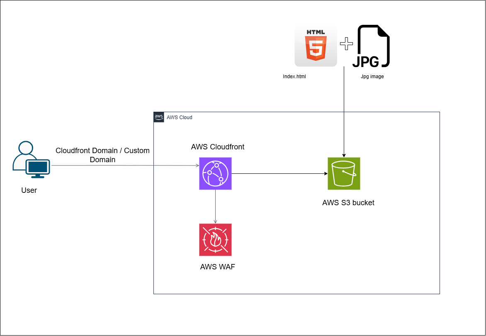

# Static Site on S3 + CloudFront

Terraform that hosts a static website (`index.html`, `hoodie-boy.jpg`) in a private S3 bucket and serves it through CloudFront. Only CloudFront can read the bucket, via Origin Access Control (OAC).

## What gets created

| Module | Resources |
|---|---|
| `modules/s3` | S3 bucket named `<bucket_name>-<environment>-<random suffix>` |
| `modules/cloudfront` | CloudFront distribution, Origin Access Control, bucket policy allowing CloudFront to read objects, WAF web ACL |

The distribution is configured to be eligible for the CloudFront **Free flat-rate plan** (see [Using the CloudFront Free plan](#using-the-cloudfront-free-plan)).

## Project layout

```
├── html   # site content
|   ├──index.html
|   |__hoodie-boy.jpg
|
└── terraform/
    ├── main.tf            # calls the s3 and cloudfront modules
    ├── provider.tf        # AWS provider (region us-east-1)
    ├── variables.tf
    ├── terraform.tfvars   # your values
    └── modules/
        ├── s3/
        └── cloudfront/
```

## Prerequisites

- [Terraform](https://developer.hashicorp.com/terraform/install) 1.x
- [AWS CLI](https://docs.aws.amazon.com/cli/latest/userguide/getting-started-install.html), with credentials that can manage S3, CloudFront and WAF
- Credentials set up through `aws configure` or environment variables. **Don't put access keys in `provider.tf`.**

```sh
aws configure
# or
export AWS_ACCESS_KEY_ID=...
export AWS_SECRET_ACCESS_KEY=...
```

## Configuration

Edit `terraform/terraform.tfvars`:

| Variable | Description | Default |
|---|---|---|
| `bucket_name` | Bucket name prefix. The final name gets `-<environment>-<random>` appended. | _required_ |
| `environment` | Environment name, used in the bucket name and tags | _required_ |
| `sid` | Bucket policy statement ID | `AllowCloudFrontServicePrincipal` |
| `effect` | Bucket policy effect | `Allow` |
| `type` | Bucket policy principal type | `Service` |
| `identifiers` | Bucket policy principals | `["cloudfront.amazonaws.com"]` |

Example:

```hcl
bucket_name = "static-site-2026"
environment = "dev"
```

## Deploy

```sh
cd terraform
terraform init
terraform plan
terraform apply
```

CloudFront can take several minutes to finish deploying.

## Upload the site

Terraform creates the bucket but doesn't upload content. Copy the files yourself, using the bucket name from the S3 console or from `terraform state show module.s3.aws_s3_bucket.s3`:

```sh
aws s3 cp index.html s3://<bucket-name>/
aws s3 cp hoodie-boy.jpg s3://<bucket-name>/
```

Then open the distribution's domain name (`dxxxxxxxx.cloudfront.net`, shown in the CloudFront console) in a browser.

After changing files, clear the cache so CloudFront serves the new versions:

```sh
aws cloudfront create-invalidation --distribution-id <id> --paths "/*"
```

## Notes on the distribution

- **Geo restriction:** only visitors from US, CA, GB, DE and LK can access the site. Change `locations` in `modules/cloudfront/main.tf` to allow other countries.
- **Caching:** uses the AWS managed `Managed-CachingOptimized` cache policy.
- **Certificate:** uses the default `*.cloudfront.net` certificate. There's no custom domain.
- **Price class:** `PriceClass_200`.

## Using the CloudFront Free plan

CloudFront's flat-rate **Free** plan costs $0/month and covers 1M requests and 100 GB of data transfer, with no overage charges. The plan requires a WAF web ACL and doesn't allow the legacy `forwarded_values`/TTL cache settings. This configuration already meets both requirements.

Terraform doesn't subscribe the distribution to the plan. After `terraform apply`:

1. Open the distribution in the CloudFront console.
2. Choose the pricing plan option and pick **Free**.

Limits:
- Accounts that are still on the AWS Free Tier can't use flat-rate plans.
- Each account can have at most 3 Free-plan distributions.
- You can't delete a distribution while it's on a plan. Cancel the plan first (Free plans cancel immediately), then run `terraform destroy`.

See [CloudFront flat-rate pricing plans](https://docs.aws.amazon.com/AmazonCloudFront/latest/DeveloperGuide/flat-rate-pricing-plan.html).

## Tear down

1. Cancel the Free plan subscription if you added one.
2. Empty the bucket: `aws s3 rm s3://<bucket-name> --recursive`
3. Run `terraform destroy` from the `terraform/` folder.
